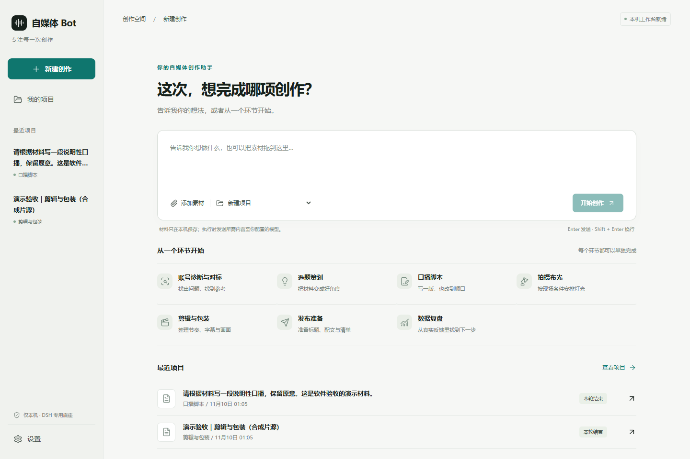
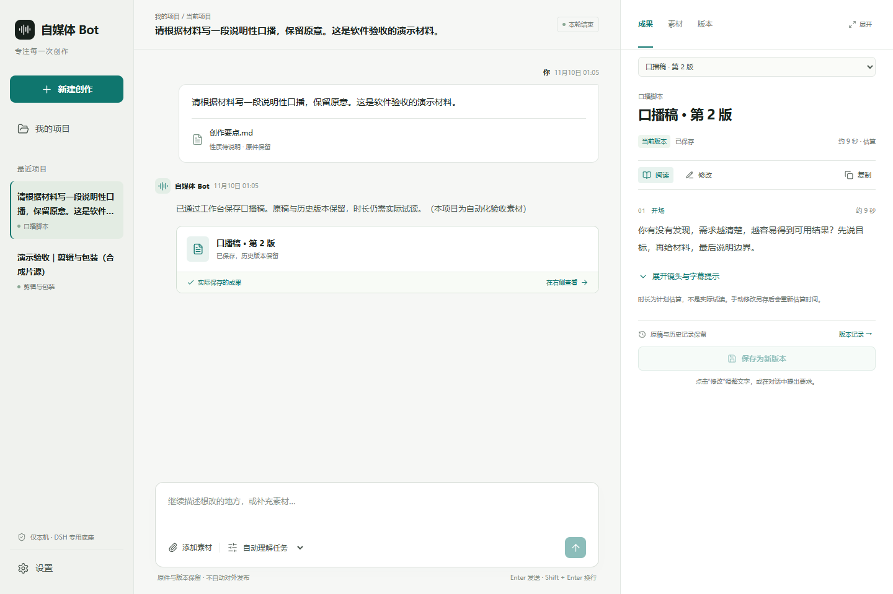
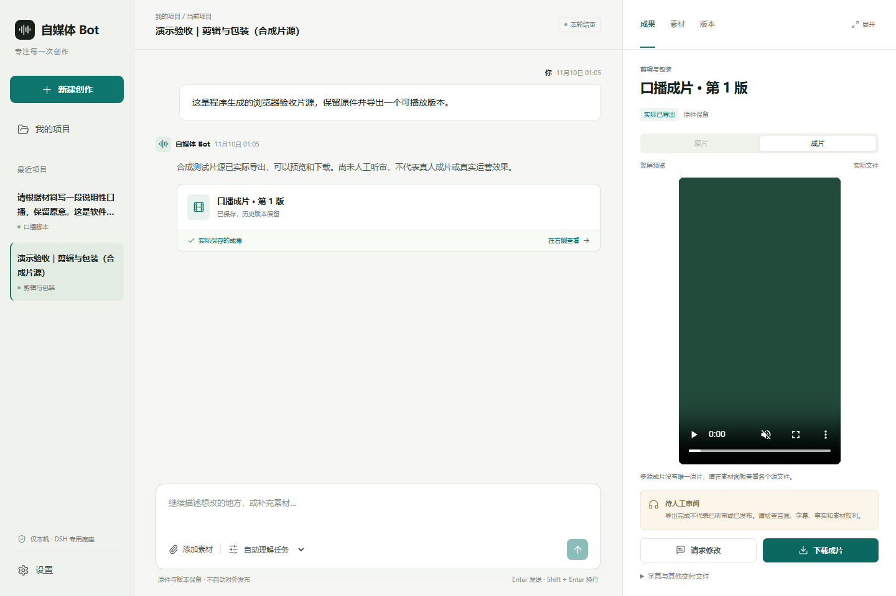

# 自媒体 Bot · Self Media Bot

[](https://github.com/MkaliezZ/self-media-bot/actions/workflows/ci.yml)

一个基于 **DeepSeek Harness（DSH）官方运行时**的本机自媒体专用 Bot。将已经具备 CLI/API 的 [自媒体工作台](https://github.com/MkaliezZ/self-media-workbench) 接入独立创作界面，不重写其业务引擎，也不做通用编程助手、云电脑或多 Bot 平台。

**一个 Bot，七种任务：**账号诊断与对标、选题策划、口播脚本、拍摄布光、剪辑与包装、发布准备、数据复盘。

## 界面

下面是实际应用截图。项目和片源来自隔离的技术验收数据，不是真实账号成绩；视频截图使用程序合成片源。



| 脚本、修改与版本 | 实际文件的视频预览 |
|---|---|
|  |  |

## 它能做什么

- 用自然语言派活，上传文本、图片、音视频，在同一项目里继续修改。
- 查看实际保存的文稿、诊断、选题、复盘和发布准备材料；没有成果时如实显示空状态。
- 口播稿可轻量编辑并另存新版本，保留原稿、引用、修改记录和时长估算。
- 布光方案展示简版/标准/理想三档、真实 SVG 布局、选择记录和试拍反馈入口。
- 实际转写、字幕校对、剪辑、现有视觉包装和原生时间轴导出；使用已有工作台能力，不是新造专业视频编辑器。
- 在浏览器预览真实成片、原片、字幕并下载交付文件。编码不受浏览器支持时可以下载检查。
- 项目、对话、素材、成果版本、本机凭据独立保存；原工作台的源码和旧项目库不改动。
- 后台状态、失败、用户问题、Bot中断、过期依赖和待人工审阅分别显示。

## 不做什么

不自动登录/抓取社交账号，不自动对外发布，不自动网上搜图，不生成图片/配音/音乐，不自动抠像/跟踪，不开放通用终端、插件商店或其他 Bot。

“发布准备”不等于已发布；“导出完成”不等于人耳听审、事实核查、版权清理或运营效果验证。缺失数据保持未知，不用模拟数字充当真实成绩。

## 环境要求

- **Node.js 24.9+**（建议24 LTS）和 npm。
- **Python 3.11+**。已有工作台时复用其解释器与依赖。
- 首次自动安装工作台需要 Git 和联网下载依赖。
- 剪辑、抽帧与音视频导出需要 `ffmpeg` / `ffprobe`。
- 转写另需兼容的本地 ASR 依赖和模型；本产品不自动下载权重，不修改全局 PATH。
- 模型使用 **DeepSeek Messages API / 兼容网关**。默认模型为 `deepseek-flash`；不是把 OpenAI Chat Completions 地址直接填进来。

文字与布光任务不要求先安装 ASR 模型。图像审阅需要模型本身具有图片输入能力。

## 快速开始

```sh
npm ci --ignore-scripts
npm run setup
npm run build
npm start
```

打开 **http://127.0.0.1:3210**，在“设置”中填写模型地址、模型名和 API Key。也可通过 `DEEPSEEK_API_KEY` 环境变量提供密钥。不要把真实密钥写进代码或提交到 Git。

Windows 可双击 **`start.cmd`**；它会检查依赖，在需要时执行基础安装/构建，然后打开本机页面。macOS/Linux 可运行 `bash start.sh`。安装过程会明确显示网络下载步骤。

`npm run setup` 优先发现已有 `media-workbench` 安装记录，不改动其源码或解释器。没有安装记录时，它把 `workbench.manifest.json` 指定的公开版本安装到本 Bot 的私有目录，并创建隔离 Python 环境。可显式指定：

```text
SELF_MEDIA_WORKBENCH_ROOT=/absolute/path/to/self-media-workbench
SELF_MEDIA_WORKBENCH_PYTHON=/absolute/path/to/its/python
```

基础安装不下载 ASR 模型。新装环境需要转写包时，可显式执行 `node scripts/setup.mjs --with-asr`，然后按工作台文档准备兼容权重和 GPU/CPU 配置。已有安装保持不变。

## 使用方式

1. 选择首页任务入口，或直接描述需求，不必先诊断再选题才能写稿/剪辑。
2. 添加素材。支持 TXT/MD/JSON/CSV、PNG/JPEG、MP4/MOV/MKV/WEBM、WAV/MP3/M4A。文本需要UTF-8且最多1,000,000字节；图片最多10MiB，音视频上传最多1GiB。
3. 开始创作；实际工作由 DSH 的工具循环调用工作台完成，不把入口返回的计划当作成果。
4. 在右侧“成果 / 素材 / 版本”查看结果。对话中提出修改，或编辑当前脚本文字后保存新版本。
5. 视频/布光成果仍需人耳听审或现场试拍。未提供真实发布数据时，复盘只做采集/实验计划。

素材和执行所需的上下文会发送到你配置的模型服务，可能产生 API 费用。连接测试也会在你明确同意后发送一次最小模型请求。

## 数据与隐私

默认私有目录为项目内 `.local/`，可用 `SELF_MEDIA_BOT_HOME` 改到另一个本机目录。里面包含对话、上传材料、独立工作台项目、DSH会话和本机加密凭据，**不属于开源源码**。

已有工作台的模型/GPU配置可复用，但旧项目库和私有知识库不会被悄悄导入。原始文件、失败记录和历史版本保留。停止 Bot 不承诺停止已经开始的独立渲染。

服务仅监听回环地址，有来源、会话和 CSRF 检查。DSH 的默认日志上传扩展已关闭；模型正常输入仍会发往所选服务。工具限制不是操作系统安全沙箱。详见 [SECURITY.md](SECURITY.md)。

## 开发与验证

```sh
npm run dev            # 本机开发预览
npm run check          # 前后端 TypeScript 检查
npm test               # 自动化测试（协议模型夹具，不调用付费外部模型）
npm run test:runtime   # 官方 DSH SDK/运行时的本地协议往返
npm run test:e2e       # 浏览器端到端验证
npm run doctor         # 只检测环境，不下载模型
npm run audit:prod     # 使用官方 npm 安全公告审计生产依赖
npm run package:release
```

`npm run test:real` 是显式、可能计费的真实模型验收：只使用自编文字，外部请求硬限制20次，单次输出不超过4096 tokens。没有授权时不要运行。私有报告不进入仓库。

测试使用真实 DSH 运行时和真实工作台；协议夹具只替代外部模型，不能作为真实模型内容质量证明。媒体测试生成独立的合成片源，不使用账号素材，不做外部发布。当前实际验收范围见 [docs/acceptance.md](docs/acceptance.md)。

## 技术结构

```text
React 创作界面（根据交付UI设计实现）
        │ 本机会话 + CSRF + 实时状态
Fastify 本机服务、项目状态和安全文件服务
        ├── 官方 DSH SDK → 官方 sdk-minimal 运行时
        │        └── self-media-only 受限工具插件
        └── 已安装且未修改的自媒体工作台 CLI/API
                 └── 原有校验、版本、布光、ASR、FFmpeg和导出
```

DSH固定为 `0.2.2-rc.1`，是开发者预览依赖。我们不另写模型工具循环；通过官方 SDK、命名 profile 和公开插件契约定制能力。界面是本产品的独立 React 实现，不声称直接使用了 DSH 的原版页面组件。`overrides` 为其部分传递依赖固定安全修复下限，完整版本以 lockfile 为准。

## 开源许可

本项目为 **MIT**，非 DeepSeek 官方产品。DSH、外部工作台、Lucide和其他依赖保留各自许可，见 [THIRD_PARTY_NOTICES.md](THIRD_PARTY_NOTICES.md)。发行包不包含真实凭据、用户素材、原始会话、模型权重或 `node_modules`。
